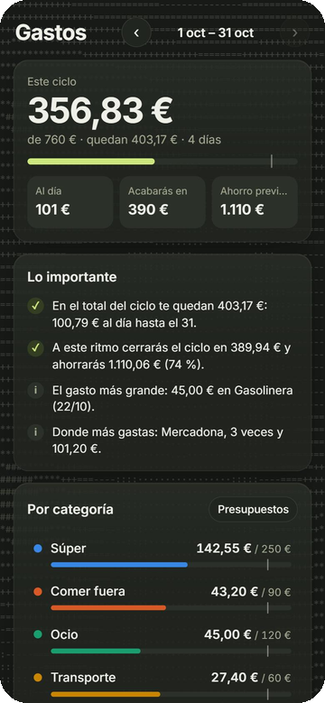

# gastos

> Cuánto queda hasta el próximo cobro, y a qué ritmo se va.

Control de gastos por ciclo de cobro: cuánto llevas, a qué ritmo vas y en qué se va, con
presupuestos por categoría. Corre en una Raspberry Pi.



<sub>Captura con datos inventados.</sub>

## Qué hace

- **Ciclo de cobro:** va del día de cobro al siguiente, no del día 1 al 31. Muestra lo gastado,
  lo que queda al día y cómo acabará el ciclo y el ahorro si sigues al mismo ritmo.
- **Lo importante:** avisos en lenguaje normal (vas por encima del presupuesto, el gasto más grande,
  dónde más gastas…).
- **Categorías con presupuesto** y una marca de dónde deberías ir a estas alturas del ciclo.
- **Apuntar rápido** desde la web, desde un atajo de iOS (`POST /api/gasto`) o desde un bot de
  Telegram, que también entiende fotos de tickets.
- **Fijos** (casa, suscripciones) y la comida de la semana, que se lee de la app de comida.
- **Varias personas, mismo código:** cada instancia arranca con su propio `.env` y sus datos aparte.

## Cómo está hecho

- FastAPI (`main.py`) y un `data.json`.
- Una página (`static/index.html`) sin compilar, con el estilo común «Calma» (`static/calma.css`
  y `static/calma.js`) y gráficas de Chart.js.
- Contraseña con cookie firmada por HMAC. En producción, además, Cloudflare Access.

## Ponerlo en marcha

```bash
uv sync
GASTOS_PASS=una-clave GASTOS_SECRET=$(openssl rand -hex 16) uv run uvicorn main:app --port 8085
```

| Variable | Para qué |
| --- | --- |
| `GASTOS_PASS`, `GASTOS_SECRET` | Contraseña y secreto de la cookie. |
| `GASTOS_DB` | Ruta del `data.json`. |
| `GASTOS_INGRESO`, `GASTOS_COBRO` | Ingreso del ciclo y día de cobro. |
| `GASTOS_NOMBRE` | Nombre que sale en el título (para una segunda instancia). |
| `GASTOS_COMIDA` | `data.json` de la app de comida (opcional). |
| `TELEGRAM_TOKEN`, `TELEGRAM_USER_ID` | Avisos por Telegram (opcional). |

Pruebas: `uv run python test_gastos.py`.
